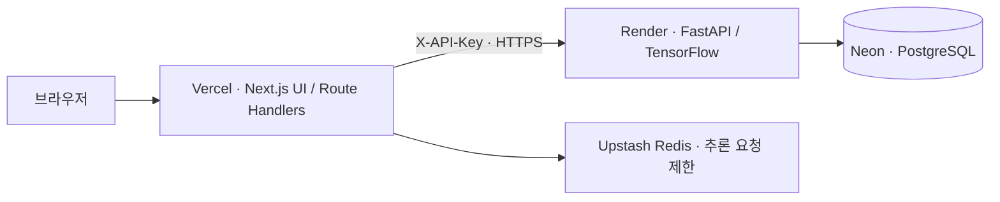

# Earthquake Event Classification
> STEAD 지진 파형 분류 모델을 웹 추론·이력 저장·클라우드 배포까지 연결한 AI 애플리케이션

[웹 데모](https://earthquake-project-seven.vercel.app/) · [FastAPI 문서](https://earthquake-project-a8z4.onrender.com/docs)

## 프로젝트 개요

3성분 지진 센서 파형으로 이벤트를 분류하는 연구 코드를 바탕으로, 모델 추론부터 API, 데이터베이스, 웹 대시보드, 클라우드 배포까지 연결한 프로젝트입니다.

ConvNetQuake 스타일의 기준 CNN과 최대 진폭 정보를 결합한 제안 모델을 구현했습니다. 제안 모델은 파형의 국소 패턴과 전역 진폭 특성을 함께 사용하는 접근을 실험하기 위한 구조입니다. 모델 간 성능 우위는 검증된 평가 결과 없이 주장하지 않습니다.

## 주요 구현

- STEAD 샘플, JSON 붙여넣기·파일 입력과 3채널 파형 시각화
- TensorFlow/Keras 모델을 이용한 FastAPI 추론
- PostgreSQL에 추론 결과 저장 및 최근 10건 이력 조회
- 새 추론 성공 후 이력 재조회, 페이지 새로고침 후 DB 이력 복원
- Next.js 서버를 통한 FastAPI 중계와 서버 간 API key 인증
- Docker 기반 로컬 API·DB 실행과 클라우드 서비스 연결
- 마이크 입력을 모델 입력 형식으로 변환하는 별도 오디오 실험

## 서비스 구성



| 구성 | 역할 |
| --- | --- |
| Next.js / React / TypeScript | 입력 검증, 파형·결과·이력 표시, 서버 API 중계 |
| FastAPI / TensorFlow / Keras | 모델 로드, 파형 검증, 분류 추론 |
| PostgreSQL / psycopg | 추론 결과 저장 및 조회 |
| Vercel / Render / Neon | 프론트엔드·백엔드·DB 클라우드 운영 |
| Docker / Docker Compose | 로컬 FastAPI·PostgreSQL 실행 환경 |
| GitHub | 소스 관리 및 연결된 배포 서비스의 자동 배포 기준 |

브라우저는 동일 출처의 Next.js API를 호출합니다. Next.js 서버가 FastAPI에 API key를 붙여 전달하며, DB 접근은 FastAPI에서 수행합니다. API key와 DB 연결 문자열은 서버 환경변수로 관리합니다.

### 요청 처리 흐름

1. 브라우저에서 입력을 검증하고 파형을 표시합니다.
2. Next.js `POST /api/predict`가 요청 크기·입력 형식을 검사하고 FastAPI `POST /predict`로 전달합니다.
3. FastAPI가 `(1000, 3)` 파형으로 추론하고 결과를 PostgreSQL에 저장합니다.
4. 저장된 기록 ID, 샘플 ID, 예측 클래스, confidence를 반환합니다.
5. 대시보드가 `GET /api/predictions`를 통해 DB의 최근 이력을 다시 조회합니다.

현재 구현은 결과 저장까지 성공해야 추론 성공 응답을 반환합니다. DB 연결 장애는 API 오류로 처리됩니다.

### 배포 확인 범위

- 사용자 운영 확인 기준으로 Vercel 프론트엔드, Render FastAPI/TensorFlow, Neon PostgreSQL을 연결했습니다.
- GitHub 저장소와 연결한 Vercel·Render 자동 배포를 사용합니다. 연결 브랜치·환경변수·자동 배포 활성화 상태는 각 서비스 대시보드에서 관리하며, 저장소에 GitHub Actions 배포 워크플로는 없습니다.
- **사용자 확인:** 로컬 Docker와 Cloudflare Tunnel을 종료한 상태에서도 배포된 웹에서 추론과 이력 조회가 성공했습니다. 클라우드 서비스 경로가 로컬 실행 환경 없이 동작하는 것을 수동 확인한 사례입니다.
- 위 확인은 상시 가용성이나 부하 성능을 보장하는 측정 결과가 아닙니다. 이 README 검토 과정에서 클라우드 추론을 새로 실행하지는 않았습니다.

## 데이터와 분류 기준

[Stanford Earthquake Dataset (STEAD)](https://github.com/smousavi05/STEAD)의 3성분 지진 파형을 사용합니다.

| 항목 | 내용 |
| --- | --- |
| 모델 입력 | 1,000개 시점 × 3채널, `(1000, 3)` |
| 클래스 0 | Micro — 전처리 코드상 규모 3 미만 지진 |
| 클래스 1 | Macro — 전처리 코드상 규모 3 이상 지진 |
| 클래스 2 | Noise — 노이즈 |

Micro/Macro는 이 프로젝트의 데이터 분할 이름입니다. Macro를 일반적인 재난 의미의 “강진”으로 해석하지 않습니다. 모델은 이벤트 클래스를 예측하며 지진 규모 자체를 회귀 예측하지 않습니다.

원본 STEAD 및 전처리 데이터 전체는 저장소에 포함하지 않습니다. 전처리·구간 추출 코드는 [src/inspect_stead.py](src/inspect_stead.py), 대시보드용 예제는 [stead-sample.json](seismic-ai-dashboard/data/stead-sample.json)에 있습니다. 전처리 코드에는 주석 처리된 학습·평가 데이터 생성 부분이 있으므로 실행 전 필요한 단계와 데이터 경로를 확인해야 합니다.

## 모델 구조

### 기준 모델

[src/baseline.py](src/baseline.py)는 채널별 시간축 평균·표준편차로 정규화한 입력에 Conv1D 계층을 적용하는 ConvNetQuake 스타일 CNN입니다. Flatten 후 softmax로 3개 클래스를 출력합니다.

### 제안 모델

[src/proposed_model.py](src/proposed_model.py)는 두 경로의 특징을 결합합니다.

- **CNN 경로:** 정규화한 파형에서 시간축의 국소 패턴을 추출합니다.
- **최대 진폭 경로:** 정규화 전 입력의 절댓값에 GlobalMaxPooling1D와 Dense 계층을 적용합니다.
- 두 특징을 결합하고 softmax로 분류합니다.

서비스는 [src/inference.py](src/inference.py)를 통해 `models/best_proposed_model.keras`를 로드합니다. 기준·제안 모델의 Keras 체크포인트가 저장소에 포함되어 있습니다.

### 성능 해석과 한계

현재 README에는 정확도·F1·모델 개선율을 기재하지 않습니다. 검토한 저장소에 재현 조건과 함께 확인할 수 있는 평가 결과가 없으며, 두 평가 스크립트에는 정의되지 않은 `output` 참조가 있습니다. 또한 기준·제안 평가 코드의 표본 구성 방식이 달라 공정한 비교 조건 정리가 필요합니다.

응답의 `confidence`는 해당 입력에서 모델이 출력한 최대 클래스 점수입니다. 전체 데이터셋 정확도나 실제 지진 발생 확률을 뜻하지 않습니다.

## 센서 파형 입력과 마이크 실험

| 입력 | 목적과 해석 |
| --- | --- |
| STEAD / 사용자 JSON | 지진 센서 파형을 모델에 전달하는 분류 경로. 사용자 데이터의 센서·전처리 조건에 따라 일반화 성능은 별도 검증 필요 |
| 마이크 | 브라우저 오디오 수집·변환·추론 연결을 확인하는 실험. 실제 지진 탐지 성능의 근거로 사용하지 않음 |

마이크 실험은 10초의 단일 오디오 신호를 필터링·리샘플링하고, 같은 값을 3채널에 복제해 입력 형식을 맞춥니다. 이는 독립적인 3성분 지진 센서 관측과 다릅니다. 화면과 코드에서 `Experimental Audio Input / 지진 감지 아님`으로 구분하며, 실험 ID는 `MIC_EXPERIMENT_`로 시작합니다. 마이크로 실제 지진을 탐지하거나 재난 경보를 제공하는 시스템이라고 주장하지 않습니다.

## 로컬 실행

### 1. 저장소 및 환경변수 준비

```bash
git clone --branch earthquake --single-branch https://github.com/Jangsu526/earthquake_project.git
cd earthquake_project
```

루트의 `.env.example`을 `.env`로 복사하고 `DB_PASSWORD`, `FASTAPI_API_KEY`를 설정합니다. 실제 비밀값은 커밋하지 않습니다.

### 2. Docker로 API와 DB 실행

Docker가 실행 중인 환경에서 프로젝트 루트에서 실행합니다.

```bash
docker compose up --build -d
docker compose exec -T db psql -U earthquake_app -d earthquake_ai < sql/docker_schema.sql
```

두 번째 명령의 입력 리다이렉션은 Bash 기준입니다. PowerShell에서는 다음을 사용합니다.

```powershell
Get-Content sql/docker_schema.sql | docker compose exec -T db psql -U earthquake_app -d earthquake_ai
```

현재 Compose 설정은 테이블 생성 SQL을 자동 실행하지 않으므로 최초 실행 시 스키마 적용이 필요합니다. API는 `http://localhost:8000`, API 문서는 `http://localhost:8000/docs`에서 확인합니다. PostgreSQL 데이터는 Compose 볼륨에 저장됩니다.

### 3. 대시보드 실행

Node.js 24.x와 npm을 사용합니다. `seismic-ai-dashboard/.env.example`을 같은 디렉터리의 `.env.local`로 복사하고 아래 값을 설정합니다.

| 환경변수 | 설정 |
| --- | --- |
| `FASTAPI_BASE_URL` | 로컬: `http://localhost:8000`, 클라우드: Render의 HTTPS 주소 |
| `FASTAPI_API_KEY` | FastAPI에 설정한 값과 동일 |
| `UPSTASH_REDIS_REST_URL` | Upstash Redis REST HTTPS URL |
| `UPSTASH_REDIS_REST_TOKEN` | Upstash Redis REST 토큰 |

Upstash 변수는 현재 예제 환경 파일에 없으므로 추가해야 합니다. 추론 요청 제한은 Redis 연결이 필요하며, 설정 누락·장애 시 추론 중계가 503을 반환합니다. 개발 환경에서는 로컬 요청들이 하나의 제한 버킷을 공유합니다.

```bash
cd seismic-ai-dashboard
npm ci
npm run dev
```

`http://localhost:3000`에 접속합니다. 서버 비밀값에 `NEXT_PUBLIC_` 접두사를 붙이지 않습니다.

Python 가상환경을 직접 구성할 경우 Dockerfile의 Python 3.10 및 의존성 파일을 참고하세요. `requirements.txt`에는 현재 API가 사용하는 psycopg·python-dotenv가 없어 API 실행용 완전한 설치 목록으로 볼 수 없습니다. 학습·평가는 별도의 STEAD 데이터 준비와 호환 환경 점검이 필요합니다.

## API와 안정성 처리

| FastAPI 경로 | 기능 | 인증 |
| --- | --- | --- |
| `GET /health` | 프로세스 상태 응답 | 없음 |
| `POST /predict` | 파형 검증, 추론, 결과 저장 | `X-API-Key` |
| `GET /predictions?limit=10` | 최신 이력 조회, limit 1~100 | `X-API-Key` |

`/health`는 DB 연결까지 확인하는 준비 상태 점검은 아닙니다.

- Next.js는 입력 JSON 크기와 파형·응답 형식을 검증합니다.
- FastAPI는 입력 형태와 유한한 숫자 여부를 검사합니다.
- Next.js 추론 경로는 Upstash 기반 요청 제한을 적용합니다.
- API key는 서버 간 호출을 보호합니다. 공개 웹 API에 사용자별 로그인·이력 소유권 분리가 구현된 것은 아닙니다.
- 추론 중계 시간 초과 시 서버에서 저장이 끝났을 수 있으므로, 이력을 확인한 뒤 재시도해야 중복 기록을 줄일 수 있습니다.

## 저장소 구조

```text
api/                       FastAPI 및 인증 테스트
src/                       전처리·학습·평가·추론·DB 코드
models/                    기준·제안 모델 체크포인트
sql/                       DB 스키마 및 SQL 연습
seismic-ai-dashboard/
  app/                     대시보드 및 Next.js API
  data/                    대시보드용 STEAD 예제
  docs/                    구현 과정과 과거 검증 기록
  scripts/                 입력·추론·이력·오디오·요청 제한 검증
Dockerfile
compose.yaml
requirements*.txt
```

## V1 / V2 모델 선택

대시보드에서 V1 Baseline CNN과 V2 Proposed(최대 진폭 결합)를 선택합니다. 같은 입력을 유지한 채 모델을 바꿔 각각 추론할 수 있습니다. 선택을 바꾸면 이전 결과는 지워지며, 실행 중에는 선택을 잠급니다.

- V1: `baseline_v1` → `models/baseline_best_model.keras`
- V2: `proposed_v2` → `models/best_proposed_model.keras`
- 요청의 `model_name`을 Next.js와 FastAPI에서 제한된 이름으로 검증합니다. 생략하면 기존 제안 모델 동작을 유지하도록 V2를 사용합니다.
- 응답과 DB에는 실행한 모델 이름을 남깁니다. 응답 모델이 요청과 다르면 성공 결과로 표시하지 않습니다.
- 과거 `proposed_v1` DB 기록은 기존 제안 모델입니다. 새 V1 Baseline으로 바꾸거나 이름을 덮어쓰지 않습니다.
- 버전은 성능 순위를 의미하지 않습니다. 마이크 입력의 실험 표시는 두 모델 모두에 적용됩니다.

배포 시 FastAPI를 먼저 갱신한 뒤 Next.js를 배포하고, 두 모델의 실제 추론·이력 이름을 확인해야 합니다. 두 모델을 프로세스 시작 시 로드하므로 메모리와 시작 시간은 단일 모델 실행과 달라질 수 있습니다. 논문에 보고된 성능과 배포 체크포인트의 성능은 별도 검증 대상입니다.
